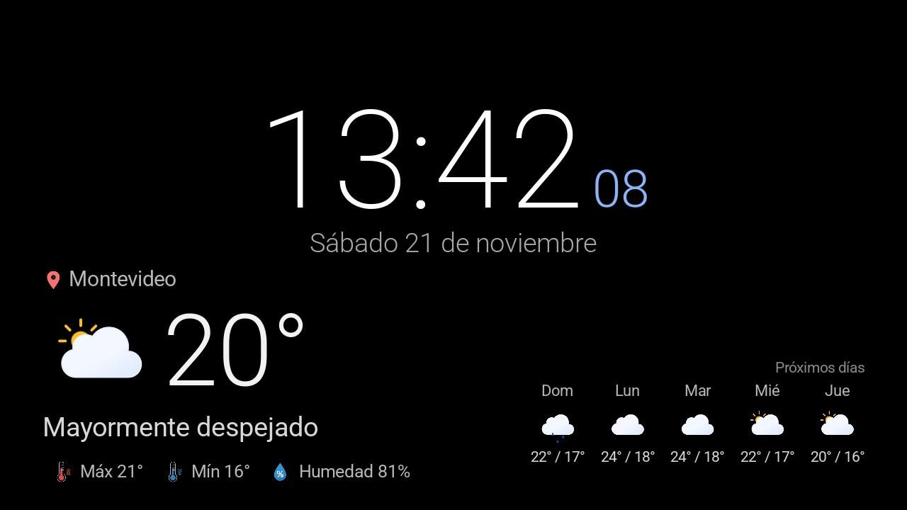
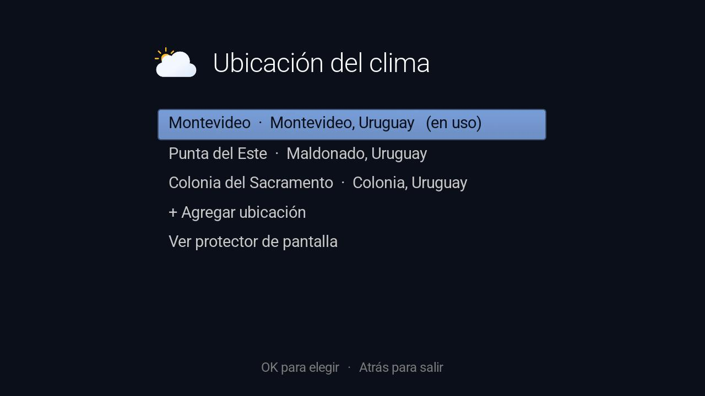

# Reloj y Clima — protector de pantalla para Roku

Protector de pantalla para Roku con un reloj grande en el centro, el clima actual y el pronóstico de los próximos días.



## Qué muestra

- **Reloj** `HH:MM` grande con los segundos al costado y la fecha en español. Se corre unos píxeles cada minuto para cuidar la pantalla.
- **Clima actual** (abajo a la izquierda): ubicación, ícono, temperatura, descripción, máxima, mínima y humedad.
- **Pronóstico** (abajo a la derecha): los próximos 5 días con ícono, máxima y mínima.
- El clima se actualiza cada 15 minutos con [Open-Meteo](https://open-meteo.com/), que es gratis y no pide clave.

## Varias ubicaciones

Al abrir la app desde el inicio de la Roku (o desde la configuración del protector de pantalla) aparece la pantalla de configuración:

- Lista de ubicaciones guardadas; la activa dice "(en uso)". OK sobre una para usarla o eliminarla.
- **+ Agregar ubicación**: busca cualquier ciudad o pueblo (los de Uruguay salen primero).
- **Ver protector de pantalla**: vista previa.



Las ubicaciones se guardan en la Roku. La ubicación por defecto es Montevideo.

## Instalación

1. Activá el **modo desarrollador** en la Roku: con el control, `Home ×3, Arriba ×2, Derecha, Izquierda, Derecha, Izquierda, Derecha`. Anotá la IP y la contraseña que elegís.
2. Empaquetá la app:
   ```sh
   ./build.sh
   ```
3. Abrí `http://<IP-de-la-Roku>` en el navegador (usuario `rokudev`) y subí `reloj-clima.zip`, o instalala directo:
   ```sh
   ROKU_IP=192.168.1.50 ROKU_PASS=tu_clave ./build.sh
   ```
4. En la Roku: **Configuración → Tema → Protectores de pantalla → Reloj y Clima (dev)**.

> Si desactivás el modo desarrollador o instalás otra app de desarrollo, la app se borra y hay que volver a instalarla.

## Estructura

```
manifest                    datos de la app y del protector
source/main.brs             entradas: RunScreenSaver, RunScreenSaverSettings, Main
components/RelojClimaView   pantalla del reloj y el clima
components/SettingsScene    configuración de ubicaciones
components/WeatherTask      pide el clima a Open-Meteo
components/SearchTask       busca ubicaciones (geocoding de Open-Meteo)
components/Storage.brs      guarda las ubicaciones en el registro de la Roku
```

## Créditos

- Íconos del clima: [Meteocons](https://github.com/basmilius/weather-icons) de Bas Milius (MIT).
- Tipografía: [Roboto](https://fonts.google.com/specimen/Roboto) (OFL).
- Datos del clima: [Open-Meteo](https://open-meteo.com/) (CC BY 4.0).

## Licencia

El código está bajo licencia [MIT](LICENSE). Los íconos, las tipografías y los datos del clima mantienen sus propias licencias (ver Créditos).
